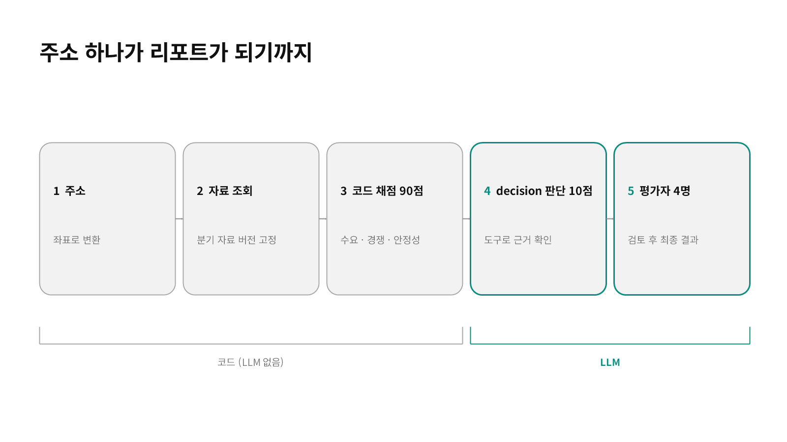

# 채움 — 공실에 맞는 업종 분석

카카오테크 캠퍼스 4기 · 강원대 1팀

빈 상가 주소 하나를 받아, 그 자리에 어떤 서비스 업종이 맞는지 근거와 한계까지 담아 임대인이 읽을 수 있는 리포트로 돌려줍니다.
추천 대상은 서비스 업종 51종입니다.

- **문제:** 임대인은 빈 상가에 어떤 업종이 맞는지 판단할 자료와 기준을 모으기 어렵습니다.
- **대상:** 입점 후보를 검토하는 임대인입니다. 실제 입점 가능성·매출·수익을 보장하는 서비스는 아닙니다.
- **데모:** 주소·층 입력 → 확인 화면에서 면적·설비 확정 → 분석·필요한 질문에 답변 → 근거와 확인 조건이 있는 보고서 조회.



- **100점 = 코드 90점 + decision 판단 10점.** 수요 35 · 경쟁 25 · 안정성 30은 코드가 계산하고, 코드가 볼 수 없는 것(주변 환경, 임대인 답변, 지표끼리의 충돌)만 decision이 10점으로 판단합니다.
- **숫자는 코드만 씁니다.** 모델은 숫자를 직접 쓰지 않고 근거(fact)를 가리키기만 하며, 문장의 숫자는 서버가 채웁니다.
- **평가자 4명이 항상 초안을 검토합니다.** 검토 의견은 decision이 한 번 반영한 뒤 서버가 최종 검증합니다.
- **자료는 분기마다 한 번 받아 둡니다.** 요청은 자료를 복사하지 않고 고정한 버전을 읽으므로, 같은 요청은 언제나 같은 자료를 근거로 삼습니다.

| 경로 | 역할 |
| --- | --- |
| [backend/](backend/README.md) | 로컬 자료 계산, decision, 평가, 저장, API |
| [frontend/](frontend/README.md) | 주소 입력과 결과 화면 |
| [docs/](docs/DATABASE.md) | 팀 규칙, API 계약, DB 구조, 설계 기록 |

## 실행

Python 3.12 환경에서 프로젝트 루트부터 실행합니다.

```powershell
conda activate chaeum
python -m pip install -e "./backend[dev]"
cd backend
python -m uvicorn app.main:create_app --factory --reload
```

별도 터미널에서 프론트를 실행합니다.

```powershell
cd frontend
npm install
npm run dev
```

화면은 <http://localhost:3000>, 백엔드 문서는 <http://localhost:8000/docs>입니다.

실제 분석에는 키 설정(`backend/.env`)과 저장소 밖 **자료 DB**가 필요합니다. 설정과 준비 방법은 [백엔드 README](backend/README.md)를 보세요.
외부 호출 없이 응답 형태만 확인하려면 `POST /api/v1/analyses?mock=true`를 호출합니다.

### 외부 호출 없는 질문·재개 데모

```bash
curl -X POST 'http://localhost:8000/api/v1/analyses?mock=true' \
  -H 'Content-Type: application/json' \
  -d '{"address":"서울 송파구 오금로 404","allow_questions":true}'
```

HTTP 200 응답 예입니다. ID는 실행마다 달라집니다. 질문이 없는 요청은 최종 DecisionResult를 바로 반환합니다.

```json
{
  "request_id": "bc458f348ab04f54a9159f2a3ffd346b",
  "status": "waiting_for_input",
  "question_session_id": "question_dcb9106c-eb14-4d18-9e62-00131dae7d0b",
  "questions": [
    {"field":"floor","question":"몇 층인가요?","reason":"층에 따라 들어올 수 있는 업종과 손님 동선이 달라져요."}
  ]
}
```

응답의 ID로 `POST /api/v1/analyses/{request_id}/answers?mock=true`에
`{"question_session_id":"받은 세션 ID","answers":{"floor":"1층"}}`을 보내면 같은 요청이 재개됩니다.
최종 결과는 `GET /api/v1/analyses/{request_id}`에서도 조회합니다. 목업은 계약·화면 연결 시험이며 추천 품질의 근거가 아닙니다.

## 문서

| 문서 | 내용 |
| --- | --- |
| [AGENTS.md](AGENTS.md) | 이 저장소에서 일하는 방법 |
| [docs/CONVENTIONS.md](docs/CONVENTIONS.md) | 코드 스타일·이름·에러 처리 |
| [docs/GIT_WORKFLOW.md](docs/GIT_WORKFLOW.md) | 브랜치·커밋·PR·리뷰 |
| [docs/API_CONTRACT.md](docs/API_CONTRACT.md) | 프론트엔드와 백엔드가 주고받는 형태 |
| [docs/DATABASE.md](docs/DATABASE.md) | 두 DB의 구조와 ERD, 갱신·백업 |
| [docs/decision-prompt-rubric.md](docs/decision-prompt-rubric.md) | 채점표와 L 판단 기준 |
| [docs/agentic-decision-plan.md](docs/agentic-decision-plan.md) | 구조 설계와 실측 기록 |
| [백엔드 실행 분기표](backend/README.md#분기예외재개-코드-찾기) | 도구 루프·실패·평가·재개 위치 |
| [docs/quality-summary.md](docs/quality-summary.md) | 실제 실행의 실패·개선 기록과 한계 |
| [docs/TESTING.md](docs/TESTING.md) | 테스트 분류·커버리지·기술 부채 |
| [docs/DEPLOY.md](docs/DEPLOY.md) | 저장소로 확인한 배포 절차와 미확인 사항 |
| [docs/archive/](docs/archive/README.md) | 이전 설계 기록 |

실제 키, 주소별 실행 기록, 자료 DB, 원문 CSV는 커밋하지 않습니다.
