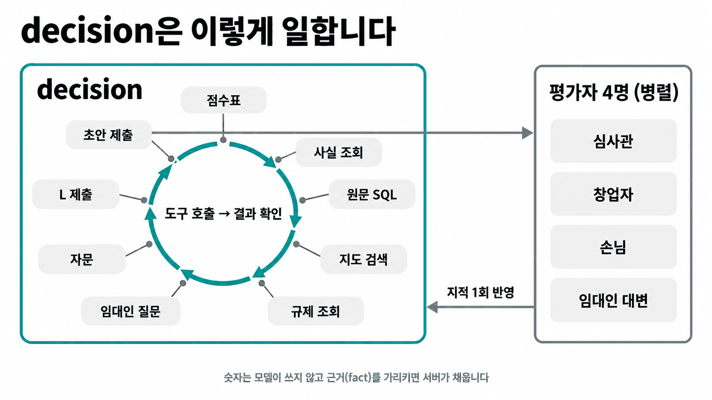

# 채움 백엔드

Python 3.12 · FastAPI · Pydantic · sqlite3 · httpx / AsyncOpenAI

주소 하나에서 고정된 분기 자료를 읽어 서비스 업종 51종을 채점하고, decision이 근거를 도구로 확인해 판단한 뒤, 평가자 4명이 검토한 최종 리포트를 돌려줍니다.
프로젝트 개요는 [루트 README](../README.md), 입력·결과 형태는 [API 계약](../docs/API_CONTRACT.md)을 따릅니다.

## 요청 한 건의 흐름

| 단계 | 하는 일 | LLM |
| --- | --- | --- |
| 1. 주소 | 주소를 좌표로 바꿉니다(주소는 공백 정리 후 200자 이내). | 없음 |
| 2. 자료 조회 | 활성 자료 버전을 고정하고 반경·상권 안의 자료만 SQL로 읽습니다. 기본 자료 API는 호출하지 않습니다. | 없음 |
| 3. 코드 채점 | 수요(D) 35 · 경쟁(C) 25 · 안정성(S) 30을 51업종 모두에 계산해 fact와 점수로 저장합니다. 규제(G)와 시설 거리(C4)도 이 단계에서 조회합니다. | 없음 |
| 4. decision | 도구로 근거를 확인하고, 임대인에게 질문하고, 51업종 전체에 L(10점)을 제출한 뒤 보고서 초안(후보 최대 5개)을 제출합니다. | 있음 |
| 5. 평가자 | examiner · founder · customer · landlord_advocate 4명이 병렬로 초안을 검토합니다. | 있음 |
| 6. 최종 | decision이 지적을 한 번 반영하고, 서버가 근거·숫자·계약을 검증해 결과를 저장합니다. | 있음 |



채점 규칙은 [채점표](../docs/decision-prompt-rubric.md)가 기준이고, 코드에서는 `app/agentic/scoring.py`가 계산합니다.

### 분기·예외·재개 코드 찾기

행 번호는 2026-10-26 기준이며 함수명을 함께 표시했습니다. 내부 루프의 질문 기본값은 true지만 공개 API 기본값은 false이며 서비스가 명시적으로 전달합니다.

| 상황 | 처리 | 코드 (`backend/` 기준) |
| --- | --- | --- |
| 도구 호출이 없거나 여러 개 | 모델 문장을 결과로 쓰지 않고 검증된 코드 점수로 대체 초안 생성 | `app/agentic/runtime.py:697` run, `:578` fallback |
| 호출·시간·토큰 예산 소진 | 미제출 L은 unknown, 기존 판단 보존 후 대체 초안 | `app/agentic/budget.py` RuntimeBudget, `runtime.py` run/fallback |
| 일시적 모델 오류 | 연결·시간 초과 및 지정 HTTP 오류만 상태에 기록하고 한 번 재시도 | `runtime.py` run의 model_retried 분기 |
| 새 정보 없는 호출 | 중복 또는 오류가 연속 세 번이면 대체 초안(일반 모드) | `runtime.py` run의 no_progress 분기 |
| 질문·재개 | 질문은 한 번, 확정 층·면적 재질문 차단. 같은 요청·자료 버전·예산으로 재개 | `app/agentic/questions.py:28` ask_user, `:67` validate_resume, `:92` resume |
| 평가자 검토 | 네 평가자를 병렬 실행하고 지적을 한 번 반영. 실패 슬롯도 결과에 남김 | `runtime.py:250` review_and_finalize, `app/agentic/evaluators.py:156` review |
| 최종 반영 실패 | 유효 초안과 완료된 평가를 보존하고 반영 미완료 한계 표시 | `runtime.py` review_and_finalize |
| 상태 저장·종료 | 요청 DB에 진행·질문·결과 저장. 계약·저장 실패는 failed로 기록 | `runtime.py:99` _save, `app/services/analysis.py` execute_agentic_analysis/resume_agentic_analysis |

대체 초안(`draft_available`)은 성공한 모델 판단과 다릅니다. 서비스는 이후 평가·최종 단계를 실행하며 결과 한계와 평가 완료율을 함께 봐야 합니다. 역할별 40k 입력 예산에는 제출 전용 예외가 있어 엄격한 누적 상한은 아닙니다([실측](../docs/founder-live-report.md)).

### 도구 목록

| 도구 | 하는 일 |
| --- | --- |
| `get_scorecard` | 업종별 점수·상태·근거 |
| `get_facts` | fact 값과 출처 계보 |
| `query_raw` | 승인된 뷰에 읽기 전용 SQL (한 번에 50행·2초·64KB 이내) |
| `map_search` | 카카오 주변 장소·거리 |
| `check_regulation` | 교육환경보호구역 등 규제(`education_zone.py`를 호출만 합니다) |
| `ask_user` | 임대인에게 층·면적·공간 상태 질문 |
| `ask_advisor` | 애매할 때만 다른 모델에게 자문(요청당 2회, 실패해도 계속) |
| `submit_l` | 업종별 L 근거 제출. 등급은 코드가 계산 |
| `submit_draft` | 보고서 초안 제출 |

평가자는 `get_scorecard`, `get_facts`, `query_raw`와 `submit_review`만 씁니다.
도구 입력은 `app/agentic/contracts.py`의 모델이 검증합니다. 모델은 요청 안에서만 유일한 8자 fact 별칭으로 근거를 가리키고, 저장과 결과에는 원래 `fact_id`가 남습니다.

### 모델이 지켜야 하는 규칙 (서버가 검증)

- 문장에 측정값(숫자)을 직접 쓰지 않고 fact를 가리킵니다. 값은 서버가 채웁니다.
- 인용한 fact는 해당 업종의 것이거나 업종과 무관한 것이어야 하고, 같은 요인을 두 번 세지 않습니다.
- L은 코드 채점(D·C·S)과 같은 요인을 다시 세지 않습니다. 새 근거가 없으면 `unknown`입니다.
- 한 업종의 위반이 나머지 업종의 제출을 막지 않습니다. 레코드 단위로 채택·거절하며 제출하지 않은 업종은 이유와 함께 `unknown`으로 채워집니다.
- 값의 상태는 `observed`(관측) · `unknown`(미확인) · `n.a.`(해당 없음)이고, 실제 0과 자료 없음은 구분합니다.

## 구조

```text
app/
  main.py · config.py · schemas.py · errors.py · address.py · geo.py · seoul.py
  api/v1/        분석·질문·답변·이벤트 HTTP 경계와 작업 슬롯
  services/      실행·재개·mock과 실패 저장
  agentic/       decision, 자문, 질문, 평가자, 채점·fact·SQL·보고서 (최종 판단 코드는 여기에 모읍니다)
  local_data/    자료 적재·활성화·버전 고정·계산 어댑터·계보
  agents/        인구·개폐업·상권 계산과 수집 클라이언트, 지도 일치 규칙
  industries/    공통 51업종·프로필·공간 요건·매핑·밀도 기준선 CSV
  llm/           모델 호출, 예산, 역할별 설정
  db/            요청 DB 연결·스키마·저장소
  storage/       요청별 원문 보관과 비밀값 마스킹
  education_zone.py   교육환경보호구역 조회 (다른 팀원 담당, 호출만 합니다)
scripts/         자료 갱신, 기준선 생성, 재현 검증
tests/           임시 DB와 API·모델 대역으로 도는 회귀 시험
```

수집 클라이언트(`app/agents/*/client.py`)는 자료 갱신과 기준선 연구에만 쓰며, 일반 분석 요청은 기본 자료 API를 다시 호출하지 않습니다.
업종 체계와 매핑은 [업종 README](app/industries/README.md), 인구·상권·지도 계산은 각 폴더의 README를 참고하세요.

## 설치·실행

프로젝트 루트에서 실행합니다.

```powershell
conda activate chaeum
python -m pip install -e "./backend[dev]"
cd backend
python -m uvicorn app.main:create_app --factory --reload
```

## API

기본 경로는 `/api/v1`이며 자세한 형태는 [API 계약](../docs/API_CONTRACT.md)에 있습니다.

| 메서드 · 경로 | 설명 |
| --- | --- |
| `POST /analyses` | 분석 시작. `wait=false`면 202와 `request_id`를 즉시 돌려줍니다. `mock=true`는 외부 호출 없이 같은 계약으로 응답합니다. 선택 `floor`·`exclusive_area_m2`는 확인 화면에서 확정한 층·전용면적으로, 공간 비교에 바로 반영합니다. |
| `GET /analyses/{request_id}` | 상태와 결과. 접수 직후에도 404가 아니라 현재 상태를 돌려줍니다. |
| `GET /analyses/{request_id}/events?after=N` | 진행 단계. 1초 간격 폴링용입니다. |
| `POST /analyses/{request_id}/answers` | `waiting_for_input`일 때 임대인 답변을 보내 재개합니다. |
| `GET /building-registry?address=` | 건축물대장 표제부·층별개요·호실·오수정화시설 조회. 상가 정보 확인 화면용이며 저장하지 않습니다. `mock=true`는 고정 응답입니다. |
| `GET /health` | 상태 확인 |

요청 상태는 `pending` → `running` → (`waiting_for_input` ↔ `running`) → `completed` 또는 `failed`입니다.
`allow_questions=false`(기본)면 임대인 질문 없이 진행합니다. 동시 실행 상한을 넘으면 429입니다.

## 설정

실제 키는 `backend/.env`에만 둡니다. 변수 이름은 [.env.example](.env.example)에 있고 값은 커밋하지 않습니다.

| 변수 | 역할 |
| --- | --- |
| `ELICE_API_KEY` · `ELICE_BASE_URL` · `ELICE_MODEL` | 공통 모델 접속. 모델마다 엔드포인트가 다르므로 모델과 주소를 함께 바꿉니다. |
| `DECISION_LLM_*` · `EVALUATOR_LLM_*` · `ADVISOR_LLM_*` | 역할별 모델·키·주소·토큰·시간·reasoning. 비우면 공통 값을 씁니다. |
| `GEOCODING_API_KEY` | 주소 변환과 지도 검색(카카오) |
| `VWORLD_API_KEY` · `VWORLD_REFERER` | 규제·서울 경계 조회(V-World) |
| `BUILDING_REGISTRY_API_KEY` | 상가 정보 확인 화면의 건축물대장 조회(공공데이터포털 건축HUB). Encoding·Decoding 두 개가 보이면 Decoding 키 |
| `LOCAL_DATA_DB_PATH` | 자료 DB 경로 |
| `SQLITE_PATH` | 요청 DB 경로 |
| `FLOATING_POPULATION_API_KEY` · `BUSINESS_LIFECYCLE_API_KEY` · `SEOUL_OPEN_API_KEY` · `COMMERCIAL_AREA_API_KEY` · `FRANCHISE_API_KEY` | **자료 갱신과 연구 스크립트용** 키. 일반 요청에는 쓰지 않습니다. |
| `MOCK_MODE` | 켜면 외부 호출 없이 고정 응답 |
| `ANALYSIS_MAX_CONCURRENCY` · `CORS_ALLOW_ORIGINS` | 백그라운드 동시 분석 수, 프론트 주소 |

모델 설정에서 주의할 점입니다.

- decision과 평가자는 도구를 쓰므로 `reasoning_effort`를 **`none`**으로 둡니다(reasoning과 도구 호출을 함께 쓸 수 없는 모델이 있습니다). 기본값은 `LLM_REASONING_EFFORT=none`입니다.
- 자문(`ADVISOR_LLM_*`)은 다른 계열 모델을 권장하며, 그 모델이 지원하지 않는 옵션은 비워 둡니다(`ADVISOR_LLM_REASONING_EFFORT`는 비우면 보내지 않습니다).

운영 예산은 한 요청에 입력 400k · 출력 60k · 모델 호출 40회 · 활성 시간 600초 · 호출당 출력 16k입니다.

## 두 DB

| 설정 | 역할 | 기본 경로 |
| --- | --- | --- |
| `LOCAL_DATA_DB_PATH` | 서울 전체 자료와 분기별 활성 release | 사용자 홈 `.chaeum/market_data.sqlite3` |
| `SQLITE_PATH` | 요청·fact·채점·질문·평가·최종 결과 | `backend/storage/chaeum.sqlite3` |

실제 분석에는 자료 DB에 완전한 활성 묶음이 있어야 합니다. 구조와 ERD, 스키마 버전, 백업·초기화 절차는 [DATABASE.md](../docs/DATABASE.md)를 보세요.
요청 DB는 이전 스키마를 자동 이전하지 않고 시작할 때 거절합니다. **자료 DB는 어떤 초기화 절차로도 삭제하지 않습니다.**

## 자료 기간

- 서비스 분석은 자료 DB의 활성 묶음을 씁니다. 2026년 10월 기준 최신 분기는 2026Q2(`20262`)입니다.
  - 개폐업: 2023Q3~2026Q2, 12분기
  - 유동인구: 2025Q2~2026Q2, 5분기
- 2023Q4(`20234`) 자료는 **백테스트 전용**입니다.
  - 2023Q4가 최신 분기인 묶음을 별도 자료 DB(예: `.chaeum/market_data_20234.sqlite3`)에 둡니다.
  - 그 시점 자료로 채점한 뒤, 그 주소에서 이후 실제로 영업을 이어 간 업종이 몇 위였는지 봅니다.
  - `backtest/history.py`는 서비스 자료 DB를 넣으면 거절합니다.
- 서비스가 2024~2026년 자료를 쓰지 않는 것이 아닙니다. 과거 시점 자료는 백테스트만 씁니다.

## 자료 갱신

`scripts/refresh_local_data.py`가 원천을 적재하고 검증한 뒤 한 트랜잭션으로 새 release를 활성화합니다. 활성·직전 release만 보존합니다.

```powershell
python scripts/refresh_local_data.py --quarter 20262 --seoul-csv D:/data/seoul.csv --shp D:/data/area.shp
python scripts/refresh_local_data.py --source floating --quarter 20262 --reset-checkpoint
```

- 필수 원천: stores · lifecycle · floating · resident · worker · areas. 서울 경계는 선택입니다.
- 개폐업 12분기, 유동 5분기가 연속이어야 하고 최신 분기가 원천 사이에 일치해야 합니다. 어긋난 묶음은 활성 자료를 바꾸지 않습니다.
- API 페이지는 하루 동안 이어받기에 재사용하며, 총 행 수가 바뀌면 처음부터 다시 받습니다. `--reset-checkpoint`는 선택 원천의 페이지 기록을 지우고 수집하고, `--dry-run`은 임시 DB에서 파일만 검증합니다.
- 상주·직장인구는 기본이 CSV이고, `--source resident --api`처럼 주면 전체 API에서 선택 분기를 받습니다. 활성화 뒤에는 파일을 줄이는 VACUUM을 실행하며 `--no-vacuum`으로 끌 수 있습니다.
- 갱신은 외부 API와 자료 DB를 바꾸므로 파일과 키를 준비한 뒤 직접 실행합니다.
- 51업종 밀도 기준선은 `app/industries/data/density_percentiles.csv`이고, `scripts/build_density_baseline.py --industries --emit`이 완전한 표본일 때만 갱신합니다.

## 자료 범위와 판단 한계

- 점포는 요청·비교 반경 안의 서울 CSV, 개폐업은 선택한 상권 폴리곤, 인구는 요청 반경과 겹치는 상권 자료를 씁니다. 같은 반경이어도 모집단은 다릅니다.
- 지도는 조회 시점의 카카오 등록 표본이며 분기 점포 전수와 더하지 않습니다.
- 서울 경계를 넘는 반경은 서울 밖 점포가 빠진다는 한계를 결과에 남깁니다.
- 업종별 공간 요건(`industry_space_requirements.csv`)은 검토 전 추정값입니다.
- 추천 점수는 성공 확률·매출·수익 예측이 아닙니다.

## 검증

```powershell
python -m ruff check .
python -m ruff format --check .
python -m mypy
python -m unittest discover -s tests
python scripts/build_industry_catalog.py --check
python scripts/verify_rubric_reproduction.py
```

자동 시험은 임시 DB와 API·모델 대역만 씁니다. 실제 API·모델 품질은 별도로 승인한 실행에서만 확인하고, 모델 호출은 `create_app(recording_dir=...)` 서버 설정으로 녹화해 같은 실행을 네트워크 없이 재생(`scripts/replay_agentic.py`)할 수 있습니다.

C1 업종별 방향 변경(2026-10-19)으로 C1 등급이 의도적으로 바뀌어 `scripts/verify_rubric_reproduction.py`의 저장 기준(`dryrun-results.json`의 408/408 일치, 배지 9/1/377/21)은 더 이상 맞지 않습니다. `backend/cache/rubric_samples`를 가진 사람이 `dryrun-results.json`과 배지 합계를 다시 만들기 전에는 이 검증이 실패하는 것이 정상입니다.

이전 설계 기록은 [docs/archive](../docs/archive/README.md)에 있고 당시 구현의 기록입니다.
