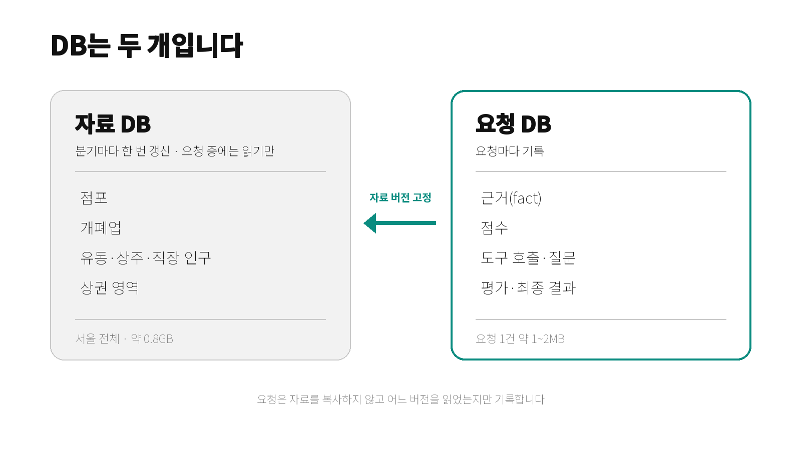
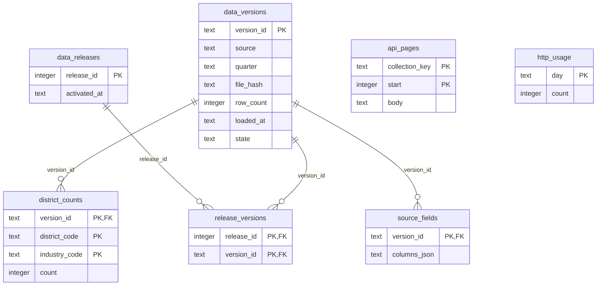
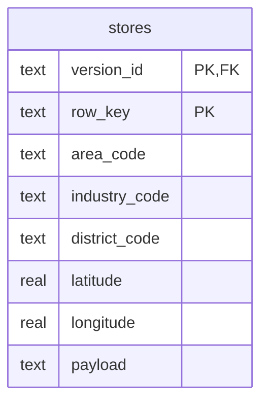
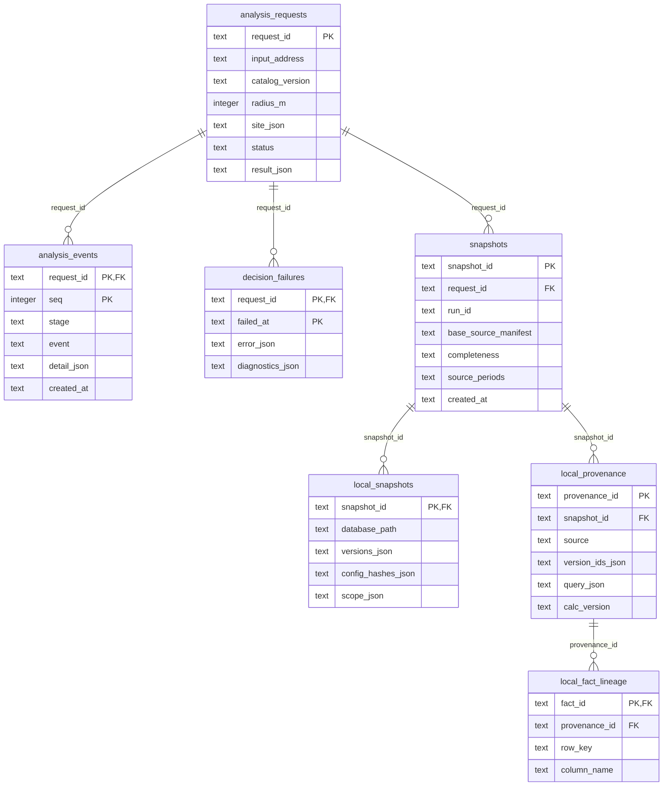
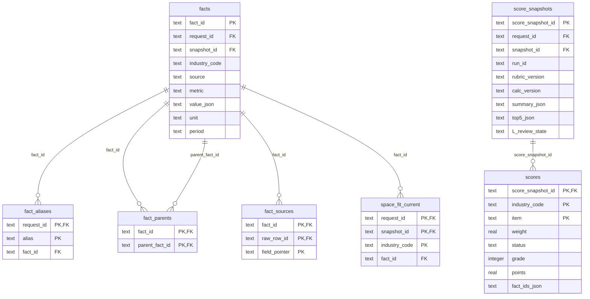
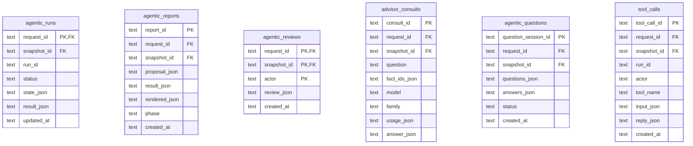
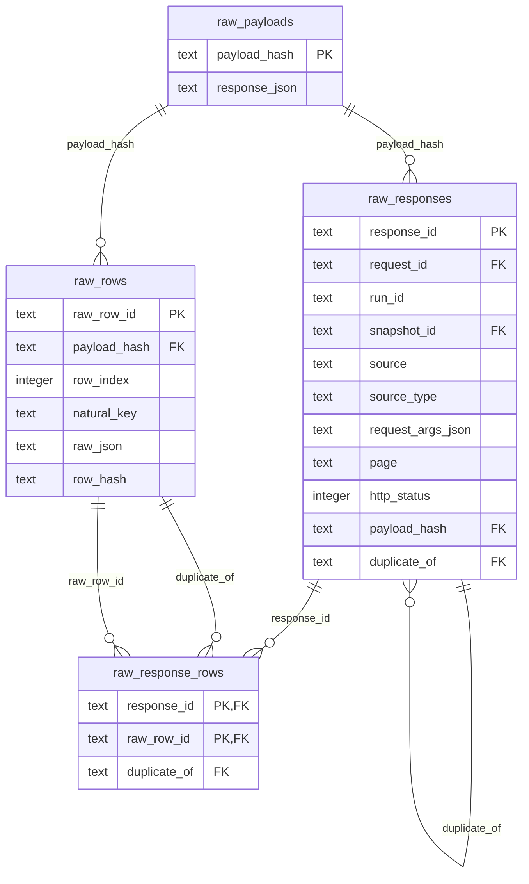

# 데이터베이스

채움은 SQLite 파일 **두 개**를 씁니다. 하나는 분기마다 바뀌는 서울 전체 자료(자료 DB), 다른 하나는 요청마다 쌓이는 결과(요청 DB)입니다.
요청은 자료를 복사하지 않고 "어느 버전을 읽었는지"만 기록합니다.

| | 자료 DB | 요청 DB |
| --- | --- | --- |
| 환경변수 | `LOCAL_DATA_DB_PATH` | `SQLITE_PATH` |
| 기본 경로 | 사용자 홈 `.chaeum/market_data.sqlite3` | `backend/storage/chaeum.sqlite3` |
| 내용 | 서울 전체 점포·개폐업·유동·상주·직장인구, 상권 영역, 구별 업종 집계 | 요청, 고정한 자료 버전, fact, 채점, 도구 호출, 질문·답변, 평가, 최종 결과 |
| 쓰는 때 | 분기 갱신 스크립트만 | 요청을 처리할 때마다 |
| 요청 중 접근 | 읽기 전용 | 읽기·쓰기 |
| 크기 | 약 0.8GB (2026년 2분기 기준) | 요청 1건에 약 1~2.5MB |
| 저장소 | **커밋하지 않습니다** | **커밋하지 않습니다** |

실제 분석에는 자료 DB의 완전한 활성 묶음이 반드시 있어야 합니다. 자료 DB는 이 문서의 어떤 절차로도 삭제하지 않습니다.

## 자료 DB

분기 갱신은 `backend/scripts/refresh_local_data.py`가 합니다. 원천을 `staged`로 적재하고 검증한 뒤, 한 트랜잭션으로 새 **release**를 활성화합니다.
검증을 통과하지 못하면 활성 자료는 바뀌지 않고, 실패한 staged 적재는 정리됩니다. 활성 release와 직전 release 하나만 보존합니다.

활성화 조건은 다음과 같습니다.

- 필수 원천: `stores`, `lifecycle`, `floating`, `resident`, `worker`, `areas`. 서울 경계(`seoul_boundary`)는 선택입니다.
- 개폐업 12분기, 유동 5분기가 연속이어야 합니다.
- 점포·개폐업·유동·상주·직장의 최신 분기가 같아야 합니다.
- 직전 활성 자료와 비교해 행 수가 크게 달라지면 거절합니다.

적재된 규모(2026년 2분기 기준)입니다.

| 원천 | 행 수 | 받는 방법 |
| --- | ---: | --- |
| 상가(소진공 서울 CSV) | 554,092 | 파일 |
| 개폐업 12분기 | 917,592 | 서울 열린데이터광장 API |
| 유동인구 5분기 | 8,242 | 서울 열린데이터광장 API |
| 상주인구 | 1,633 | CSV |
| 직장인구 | 1,641 | CSV |
| 상권 영역(SHP) | 1,650 | 파일 |

원천 테이블은 모두 같은 모양입니다: `stores`, `lifecycle`, `floating`, `resident`, `worker`, `areas`, `seoul_boundary`. 행은 `(version_id, row_key)`가 기본키이고, 원문은 `payload`에 그대로 보관합니다.

원천 테이블 한 개의 열은 다음과 같습니다(나머지도 같습니다).

`api_pages`와 `http_usage`는 갱신 스크립트 전용입니다(받은 페이지 이어받기, 하루 호출 수 집계).

## 요청 DB

스키마 버전은 **5**입니다(`backend/app/db/connection.py`의 `SCHEMA_VERSION`). 이전 버전은 자동 이전하지 않고 시작할 때 거절합니다.
거절되면 서버를 멈추고 기존 요청 DB와 `-wal`·`-shm` 파일을 저장소 밖으로 옮긴 뒤 다시 시작하세요. 새 요청 DB가 만들어집니다.

테이블은 네 묶음으로 나뉩니다. 모든 행은 `request_id`와 `snapshot_id`로 묶이고, 다른 요청의 행은 읽을 수 없게 뷰와 트리거가 막습니다.

### 1. 요청과 고정한 자료 버전

`snapshots`는 요청 하나당 하나입니다. `local_snapshots`가 이 요청이 읽은 자료 버전 목록과 조회 범위를 기록해서, 활성 release가 바뀌어도 같은 요청은 같은 버전을 읽습니다.

### 2. fact와 채점

숫자는 모두 `facts`의 한 행입니다. fact는 한 번 만들면 수정·삭제할 수 없습니다(트리거). 모델에게는 요청 안에서만 유일한 8자 별칭(`fact_aliases`)을 보여 주고, 저장과 최종 결과에는 원래 `fact_id`를 씁니다.
`space_fit_current`는 임대인 답변과 업종 공간 요건을 대조한 공간 적합 fact를 업종마다 하나씩 가리킵니다.

### 3. 실행 기록과 평가

### 4. 요청별 원문 보관

지도 검색, 규제 조회, 임대인 답변처럼 요청 중에 생기는 원문을 보관합니다. 같은 응답은 해시로 한 번만 저장합니다. 모델이 쓰는 읽기 전용 SQL 뷰(`v_raw_*`)는 현재 요청의 범위만 보이도록 제한됩니다.

### 계보: 숫자에서 원문까지

보고서의 숫자 하나는 다음 순서로 원문 행까지 따라갈 수 있습니다.

| 단계 | 저장 위치 |
| --- | --- |
| 보고서 문장의 숫자 자리 | 문장에는 `fact` 참조만 있고 값은 서버가 채웁니다 |
| fact | `facts` (값, 단위, 기간, 상태) |
| 파생 fact의 부모 | `fact_parents` |
| 조회 조건·계산 버전 | `local_provenance` |
| 직접 인용한 셀 | `local_fact_lineage` (행 키와 열) |
| 자료 버전 | 자료 DB `data_versions` (분기, 파일 해시) |

값의 상태는 `observed`(관측), `unknown`(미확인), `n.a.`(해당 없음) 셋입니다. 실제 0과 자료 없음은 구분해서 저장합니다.

## 갱신·백업

- 자료 갱신은 요청과 분리합니다. 요청 중에는 기본 자료 API를 호출하지 않습니다. 명령은 [백엔드 README](../backend/README.md#자료-갱신)를 보세요.
- 자료 DB를 옮기거나 교체할 때는 서버를 멈추고 파일 한 개(`-wal`·`-shm` 포함)를 통째로 복사합니다.
- 요청 DB는 스키마 버전이 바뀌면 위 절차로 새로 만듭니다.
