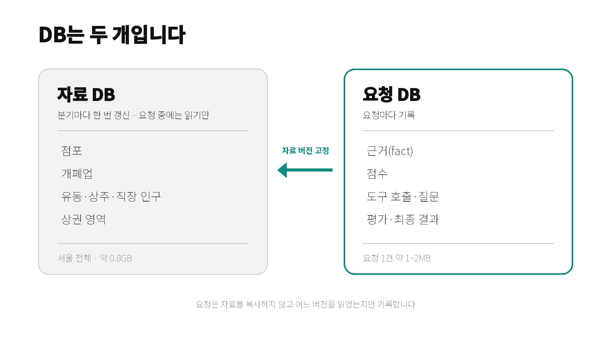
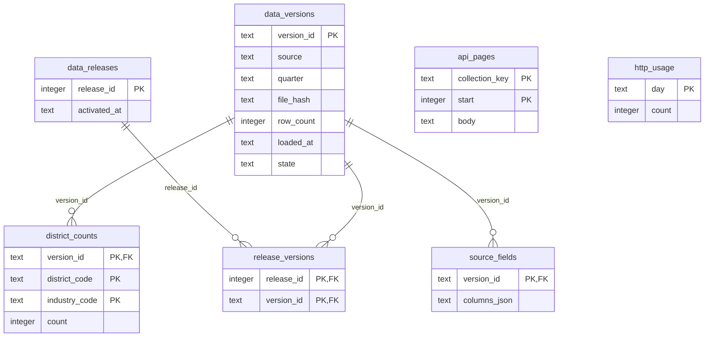
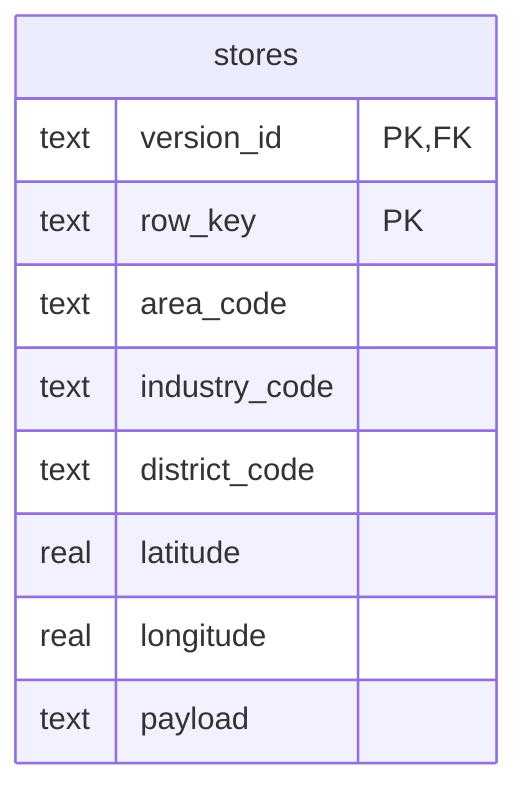
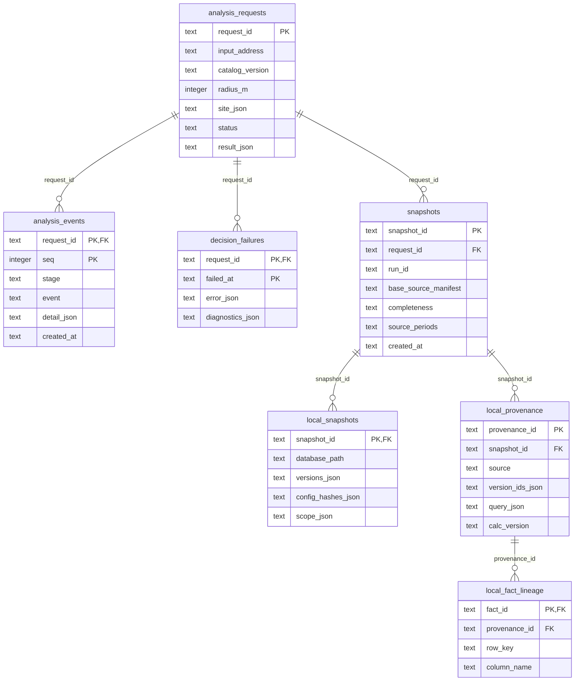
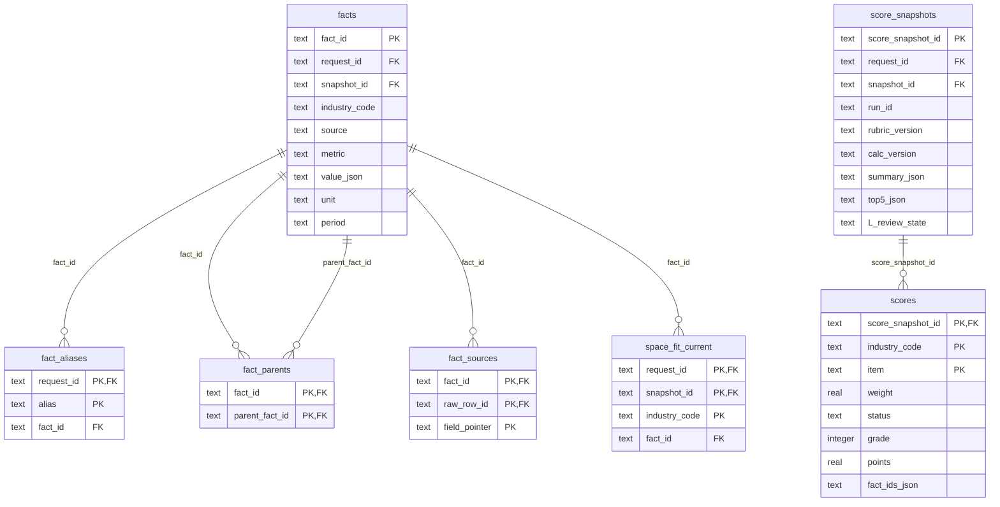
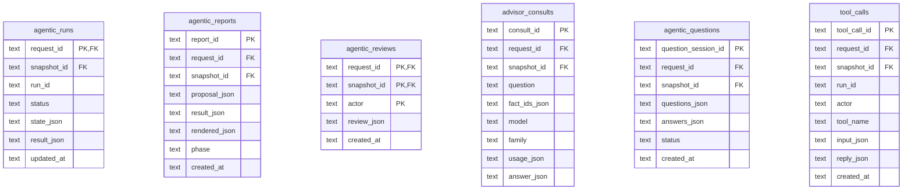
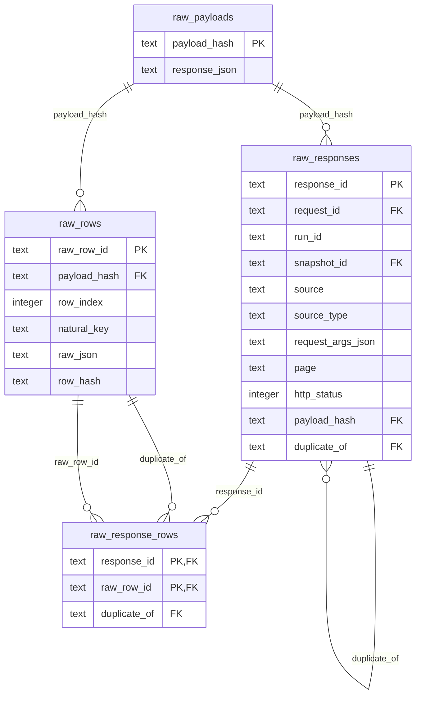

# 데이터베이스

채움은 SQLite 파일 **두 개**를 씁니다. 하나는 분기마다 바뀌는 서울 전체 자료(자료 DB), 다른 하나는 요청마다 쌓이는 결과(요청 DB)입니다.
요청은 자료를 복사하지 않고 "어느 버전을 읽었는지"만 기록합니다.



| | 자료 DB | 요청 DB |
| --- | --- | --- |
| 환경변수 | `LOCAL_DATA_DB_PATH` | `SQLITE_PATH` |
| 기본 경로 | 사용자 홈 `.chaeum/market_data.sqlite3` | `backend/storage/chaeum.sqlite3` |
| 내용 | 서울 전체 점포·개폐업·유동·상주·직장인구, 상권 영역, 구별 업종 집계 | 요청, 고정한 자료 버전, fact, 채점, 도구 호출, 질문·답변, 평가, 최종 결과 |
| 쓰는 때 | 분기 갱신 스크립트만 | 요청을 처리할 때마다 |
| 요청 중 접근 | 읽기 전용 | 읽기·쓰기 |
| 크기 | 약 0.8GB (2026년 2분기 기준) | 요청 1건에 약 1~2.5MB |
| 저장소 | **커밋하지 않습니다** | **커밋하지 않습니다** |

실제 분석에는 자료 DB의 완전한 활성 묶음이 반드시 있어야 합니다. 자료 DB는 이 문서의 어떤 절차로도 삭제하지 않습니다.

## 자료 DB

분기 갱신은 `backend/scripts/refresh_local_data.py`가 합니다. 원천을 `staged`로 적재하고 검증한 뒤, 한 트랜잭션으로 새 **release**를 활성화합니다.
검증을 통과하지 못하면 활성 자료는 바뀌지 않고, 실패한 staged 적재는 정리됩니다. 활성 release와 직전 release 하나만 보존합니다.

활성화 조건은 다음과 같습니다.

- 필수 원천: `stores`, `lifecycle`, `floating`, `resident`, `worker`, `areas`. 서울 경계(`seoul_boundary`)는 선택입니다.
- 개폐업 12분기, 유동 5분기가 연속이어야 합니다.
- 점포·개폐업·유동·상주·직장의 최신 분기가 같아야 합니다.
- 직전 활성 자료와 비교해 행 수가 크게 달라지면 거절합니다.

적재된 규모(2026년 2분기 기준)입니다.

| 원천 | 행 수 | 받는 방법 |
| --- | ---: | --- |
| 상가(소진공 서울 CSV) | 554,092 | 파일 |
| 개폐업 12분기 | 917,592 | 서울 열린데이터광장 API |
| 유동인구 5분기 | 8,242 | 서울 열린데이터광장 API |
| 상주인구 | 1,633 | CSV |
| 직장인구 | 1,641 | CSV |
| 상권 영역(SHP) | 1,650 | 파일 |

원천 테이블은 모두 같은 모양입니다: `stores`, `lifecycle`, `floating`, `resident`, `worker`, `areas`, `seoul_boundary`. 행은 `(version_id, row_key)`가 기본키이고, 원문은 `payload`에 그대로 보관합니다.



원천 테이블 한 개의 열은 다음과 같습니다(나머지도 같습니다).



`api_pages`와 `http_usage`는 갱신 스크립트 전용입니다(받은 페이지 이어받기, 하루 호출 수 집계).

## 요청 DB

스키마 버전은 **7**입니다(`backend/app/infrastructure/persistence/connection.py`의 `SCHEMA_VERSION`).

- **더 새로운 버전은 거절하지 않습니다.** 옛 코드가 새 파일을 만나도 그대로 씁니다. 막으면 새 버전을 배포한 뒤 구 릴리스로 되돌아갈 길이 사라집니다(무중단 배포는 헬스체크 실패 시 구 릴리스로 되돌립니다).
- **옛 버전은 `_UPGRADABLE_FROM`에 있을 때만 올립니다.** 지금은 `{5, 6}`입니다. `schema.sql`이 전부 `IF NOT EXISTS`라 테이블·인덱스를 **추가만** 하는 변경은 스키마를 다시 실행하는 것으로 올라갑니다. 기존 테이블의 칼럼이나 제약을 바꾸는 변경은 여기 더하지 말고 별도 절차를 만드세요.
- 목록에 없는 옛 버전은 전처럼 거절합니다. 서버를 멈추고 기존 요청 DB와 `-wal`·`-shm` 파일을 저장소 밖으로 옮긴 뒤 다시 시작하세요.
- 적용 순서는 **스키마 → 필수 표 확인 → 버전 기록**입니다. 버전을 먼저 쓰면 DDL이 실패했을 때 "표는 없는데 버전만 최신"인 파일이 남아 다음 기동에서 검사를 통과해 버립니다.

테이블은 다섯 묶음으로 나뉩니다. 모든 행은 `request_id`와 `snapshot_id`로 묶이고, 다른 요청의 행은 읽을 수 없게 뷰와 트리거가 막습니다.

### 1. 요청과 고정한 자료 버전

`snapshots`는 요청 하나당 하나입니다. `local_snapshots`가 이 요청이 읽은 자료 버전 목록과 조회 범위를 기록해서, 활성 release가 바뀌어도 같은 요청은 같은 버전을 읽습니다.

`config_hashes_json`(새 fact의 `input_versions`에도 들어감)의 키는 `industry_profile`·`code90`·`code90_reference`·`population_baseline`·`density_baseline`·`lifecycle_baseline`입니다. 값은 업종 프로필 CSV만 파일 해시이고, 나머지는 설정 행(방법·가중치·기준값·`REFERENCE_VERSION`)의 내용 해시라서 파일을 옮기거나 import 줄을 고쳐도 바뀌지 않습니다. 2026-11 구조 개편 전 결과는 `파일명+폴더명` 키와 파일 해시를 썼으며, 저장만 하고 다시 검증하지 않으므로 그대로 둡니다. 유동인구·밀도 기준선 행에는 계산 함수 버전(`METHOD`)도 들어갑니다. 기준선 모듈의 코드·값, 그리고 가져다 쓰는 `stats.percentile_rank`·`population.TIME_BANDS`가 바뀌면 `tests/test_snapshot_config_keys.py`가 버전을 올리라며 실패합니다. 그 밖의 모듈에서 가져온 함수는 지문에 들어가지 않으니, 기준선 계산에 새 도우미를 쓰면 지문 대상에 함께 넣습니다. 2026-11-07 이 버전을 넣으면서 두 기준선 해시가 한 번 바뀌었습니다(이후 새 분석만 해당).



### 2. fact와 채점

숫자는 모두 `facts`의 한 행입니다. fact는 한 번 만들면 수정·삭제할 수 없습니다(트리거). 모델에게는 요청 안에서만 유일한 8자 별칭(`fact_aliases`)을 보여 주고, 저장과 최종 결과에는 원래 `fact_id`를 씁니다.
`space_fit_current`는 임대인 답변과 업종 공간 요건을 대조한 공간 적합 fact를 업종마다 하나씩 가리킵니다.



### 3. 실행 기록과 평가



### 4. 요청별 원문 보관

지도 검색, 규제 조회, 임대인 답변처럼 요청 중에 생기는 원문을 보관합니다. 같은 응답은 해시로 한 번만 저장합니다. 모델이 쓰는 읽기 전용 SQL 뷰(`v_raw_*`)는 현재 요청의 범위만 보이도록 제한됩니다.



### 5. 계정과 세션

인증용 표입니다. 분석 자료와 달리 불변 트리거가 없고 지울 수 있습니다.

| 표 | 하는 일 |
| --- | --- |
| `users` | 계정. `email`·`password_hash`는 소셜로만 들어온 사람에게는 비어 있습니다 |
| `user_identities` | 로그인 수단. `(provider, provider_user_id)`가 기본키이고 `users`를 가리킵니다 |
| `user_sessions` | 로그인 세션. 쿠키 원문이 아니라 **sha256 해시**만 둡니다 |
| `oauth_states` | 카카오 왕복용 1회용 난수와 돌아갈 경로 |
| `email_tokens` | 가입 확인·비밀번호 재설정 링크. 여기도 **해시만** 둡니다 |
| `login_attempts` | 무차별 대입 방어용 시도 기록 |
| `analysis_owners` | 요청과 사용자를 잇습니다 |
| `terms_agreements` | 약관 동의 기록. `(user_id, terms_version)`이 기본키이고 계정을 지우면 함께 지워집니다 |

**계정과 로그인 수단을 나눈 이유.** 한 표에 합치면 이메일로 가입한 사람이 나중에 카카오로
들어왔을 때 계정이 둘로 갈립니다. 나눠 두면 기존 계정에 수단을 **붙일** 수 있고,
구글·네이버를 더할 때도 `provider`의 CHECK만 풀면 됩니다.

**소유자를 `analysis_requests`의 칼럼으로 넣지 않은 이유.** `api/v1/analyses.py`의 `detail()`이
`SELECT *`를 그대로 응답 본문으로 내보냅니다. 칼럼을 더하면 `user_id`가 자동으로 외부에 노출됩니다.
`space_fit_current`와 같은 '옆 표' 방식을 씁니다.

**옛 요청.** 소유자가 없는 요청은 아무도 열 수 없습니다. 인증을 붙이기 전에 쌓인 요청도 같습니다.

**탈퇴.** `facts`·`scores` 등에 삭제 금지 트리거가 걸려 있어 분석 자료는 지울 수 없습니다.
탈퇴는 계정·세션·소유 연결만 지우는 **익명화**입니다. 카카오 액세스 토큰을 보관하지 않으므로
카카오 쪽 연결 끊기는 하지 못합니다. 메일로 받은 탈퇴는 `scripts/withdraw_user.py <요청 DB 경로> <계정 번호>`로
처리합니다(아래 절차). API 탈퇴(`DELETE /api/v1/auth/me`)와 같은 `users.delete_user`를 불러 메일 토큰·로그인 수단·약관 동의까지
지우고 한 줄 결과를 출력합니다. 없는 계정이면 종료 코드 1입니다.

**질문 답 지우기.** `scripts/erase_user_answers.py <요청 DB 경로> <요청 번호>`는 그 요청의 질문 답 글만
`[삭제됨]`으로 바꾸고(숫자·키·식별자·시각·상태 값은 그대로) 바꾼 행 수를 출력합니다(없는 요청이거나 지울 답이 없으면 0).
답을 받은 뒤 분석이 아직 이어지는 중이면 아무것도 바꾸지 않고 종료 코드 1로 끝납니다. 다른 요청과 함께 쓰는 원문(`raw_payloads`)은 고치지 않고 이 요청 몫만 새 원문으로
떼어 냅니다. 불변 트리거는 그 트랜잭션 안에서만 내렸다가 다시 걸고, 실패하면 모두 되돌립니다. 확인 화면에서 확정한
층·면적·설비는 질문 답이 아니라 그대로 둡니다. 이미 AI 제공자에게 전달된 내용은 지울 수 없습니다.

**메일로 받은 요청 처리 절차.** 계정 설정 화면이 생기기 전까지 운영자가 서버에서 처리합니다.

1. 계정을 찾습니다. 이메일 가입자는 가입한 주소에서 온 메일만 받고 `SELECT user_id FROM users WHERE email=?`로
   찾습니다(도메인은 소문자로 저장). 카카오 가입자는 계정에 이메일이 없으므로 "내 분석 기록"에서 연 화면 주소의
   `id=` 값(요청 번호)과 그 분석에 입력한 상가 주소를 받아,
   `SELECT o.user_id, r.input_address FROM analysis_owners o JOIN analysis_requests r USING(request_id) WHERE o.request_id=?`의
   주소와 맞을 때만 처리합니다.
2. 질문 답도 지워 달라고 하면 탈퇴보다 먼저 지웁니다. 탈퇴하면 소유 연결이 끊겨 어느 분석이 그 사람 것인지 알 수 없습니다.
   탈퇴 스크립트에 `--erase-answers`를 주면 그 계정의 분석마다 답을 먼저 지우고 탈퇴합니다. 답을 받은 뒤 아직 이어지는
   분석이 있으면 탈퇴하지 않고 종료 코드 1로 끝나므로 분석이 끝난 뒤 다시 돌립니다.
3. SSM으로 서버에 들어가 서비스와 같은 `ubuntu` 사용자로, 서버 가상환경의 파이썬으로 돌립니다. 다른 사용자로 돌리면 DB 옆
   `-wal`·`-shm` 파일 권한이 꼬입니다. 요청 DB 경로는 서비스 설정의 `SQLITE_PATH`입니다.

   ```bash
   sudo -iu ubuntu
   cd /opt/chaeum/current/backend
   /opt/chaeum/shared/venv/bin/python scripts/erase_user_answers.py /opt/chaeum/shared/storage/chaeum.sqlite3 <요청 번호>
   /opt/chaeum/shared/venv/bin/python scripts/withdraw_user.py /opt/chaeum/shared/storage/chaeum.sqlite3 <계정 번호> --erase-answers
   ```

4. 지우기는 한 트랜잭션 동안 요청 DB 쓰기 잠금을 잡아 그사이 분석 저장이 기다리므로, 사용이 적은 시간에 돌립니다.

### 계보: 숫자에서 원문까지

보고서의 숫자 하나는 다음 순서로 원문 행까지 따라갈 수 있습니다.

| 단계 | 저장 위치 |
| --- | --- |
| 보고서 문장의 숫자 자리 | 문장에는 `fact` 참조만 있고 값은 서버가 채웁니다 |
| fact | `facts` (값, 단위, 기간, 상태) |
| 파생 fact의 부모 | `fact_parents` |
| 조회 조건·계산 버전 | `local_provenance` |
| 직접 인용한 셀 | `local_fact_lineage` (행 키와 열) |
| 자료 버전 | 자료 DB `data_versions` (분기, 파일 해시) |

값의 상태는 `observed`(관측), `unknown`(미확인), `n.a.`(해당 없음) 셋입니다. 실제 0과 자료 없음은 구분해서 저장합니다.

## 갱신·백업

- 자료 갱신은 요청과 분리합니다. 요청 중에는 기본 자료 API를 호출하지 않습니다. 명령은 [백엔드 README](../backend/README.md#자료-갱신)를 보세요.
- 자료 DB를 옮기거나 교체할 때는 서버를 멈추고 파일 한 개(`-wal`·`-shm` 포함)를 통째로 복사합니다.
- 요청 DB는 올릴 수 있는 버전이면 기동할 때 알아서 올라갑니다. 올리기 전에 `sqlite3 chaeum.sqlite3 ".backup '백업경로'"`로 온라인 백업을 뜨세요. `cp`는 `-wal` 때문에 찢어진 사본이 됩니다. 올릴 수 없는 버전이면 위 절차로 새로 만듭니다.
